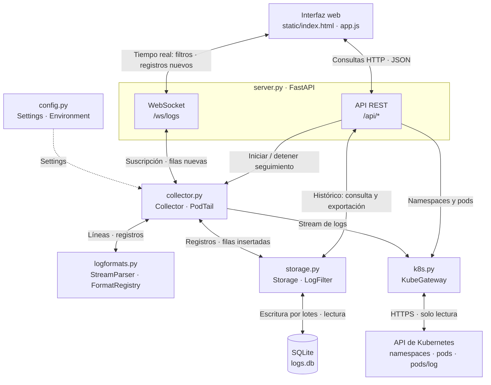

# Web K8s Logs Viewer

Herramienta web para consultar, filtrar y correlacionar los logs de microservicios desplegados en Kubernetes. Está pensada para que los equipos de QA y desarrollo diagnostiquen defectos desde el navegador, sin ejecutar `kubectl` por cada pod.

Funciona con cualquier clúster accesible desde un kubeconfig (EKS, AKS, GKE, OpenShift, Rancher, kind, minikube u on-premise) y su acceso a Kubernetes es **de solo lectura**.

## Contenido

- [Funcionalidades](#funcionalidades)
- [Arquitectura](#arquitectura)
- [Requisitos](#requisitos)
- [Instalación y ejecución](#instalación-y-ejecución)
- [Uso](#uso)
- [Configuración](#configuración)
- [API](#api)
- [Entorno de demostración](#entorno-de-demostración)
- [Pruebas](#pruebas)
- [Validación en clúster](#validación-en-clúster)
- [Estructura del repositorio](#estructura-del-repositorio)
- [Seguridad](#seguridad)
- [Licencia](#licencia)

## Funcionalidades

- **Navegación por recursos:** lista los workloads (Deployment, StatefulSet, DaemonSet, Job, CronJob…) con sus pods y contenedores, estado, READY y reinicios. El workload se obtiene de las `ownerReferences` de cada pod.
- **Seguimiento en tiempo real** de los contenedores elegidos. Si la conexión se cae, reintenta con backoff exponencial y reanuda desde la última marca de tiempo, sin perder ni duplicar líneas.
- **Seguimiento de reemplazos:** si un pod seguido desaparece (rollout, escalado o eliminación), sigue automáticamente el pod nuevo del mismo workload.
- **Detección del formato de cada log**, con extracción de nivel, logger, hilo y trace/correlation id:

  | Formato | Ejemplos |
  |---|---|
  | `json` | Logback/ECS, pino, Serilog, zap |
  | `spring_boot`, `logback`, `log4j` | Java |
  | `python`, `python_basic`, `uvicorn` | Python |
  | `dotnet` | Consola de .NET |
  | `klog`, `zap_console` | Go |
  | `http_access` | Accesos de nginx/Apache |
  | `logfmt`, `generic`, `plain` | Otros |

  Se pueden declarar formatos propios con expresiones regulares en `config.yaml`.
- **Agrupación multilínea:** stack traces de Java, tracebacks de Python y mensajes de .NET quedan en un solo registro con el nivel correcto.
- **Histórico en SQLite** con retención automática y filtros por nivel, workload, pod, formato, texto o regex, exclusión, trace id y rango de fechas (hora local o UTC).
- **Trazabilidad:** un clic sobre el trace id de un registro muestra todos los registros relacionados de cualquier servicio.
- **Instancia anterior:** recupera los logs del contenedor que falló, por ejemplo en un `CrashLoopBackOff`.
- **Exportación** de los resultados filtrados a TXT, CSV o JSONL.

## Arquitectura

La aplicación es un único proceso Python: `main.py` carga la configuración y sirve una aplicación FastAPI con uvicorn.



| Módulo | Responsabilidad |
|---|---|
| `webapp/config.py` | Lee `config.yaml` y las variables `PODS_*`. |
| `webapp/k8s.py` | `KubeGateway`: conexión por kubeconfig o *in-cluster*. Solo usa `list_namespace`, `list_namespaced_pod`, `read_namespaced_pod` y `read_namespaced_pod_log`. |
| `webapp/collector.py` | Un hilo `PodTail` por pod y contenedor: lectura del stream, reconexión, reanudación con `since_seconds` y seguimiento de reemplazos. |
| `webapp/logformats.py` | Detección de formato y nivel, extracción del trace id y agrupación multilínea. |
| `webapp/storage.py` | SQLite en modo WAL: escritura por lotes con `INSERT OR IGNORE` sobre un índice único (deduplicación), retención y filtros (`LogFilter`) comunes al histórico y al tiempo real. |
| `webapp/server.py` | API REST, WebSocket y servicio de la interfaz. |
| `webapp/static/` | Interfaz web en HTML, CSS y JavaScript, sin paso de compilación. |

**Histórico frente a tiempo real.** La consulta histórica traduce los filtros a SQL sobre SQLite. En tiempo real, el almacenamiento notifica las filas que realmente se insertaron; el recolector las distribuye a cada cliente WebSocket y el servidor envía solo las que cumplen el filtro de ese cliente. Como ambas vías usan la misma clase `LogFilter`, un filtro da el mismo resultado en las dos vistas.

## Requisitos

- Python 3.10 o superior. Probado con Python 3.12.
- Un kubeconfig con permisos de lectura sobre `pods` y `pods/log` (y, opcionalmente, para listar `namespaces`). El manifiesto [deploy/rbac-readonly.yaml](deploy/rbac-readonly.yaml) define una cuenta de servicio con esos permisos mínimos.
- El inicio de sesión del proveedor se hace por fuera de la herramienta, como con `kubectl`:

  | Proveedor | Comando |
  |---|---|
  | AWS EKS | `aws sso login --profile <perfil>` y `aws eks update-kubeconfig --name <cluster> --region <region> --profile <perfil>` |
  | Azure AKS | `az login` y `az aks get-credentials -g <grupo> -n <cluster>` |
  | Google GKE | `gcloud auth login` y `gcloud container clusters get-credentials <cluster> --region <region>` |
  | OpenShift | `oc login <url>` |
  | Local | `kind create cluster --name pods-demo` o `minikube start` |

`kubectl` no es necesario para usar la herramienta, que usa el cliente oficial de Kubernetes para Python. Sí lo es para el entorno de demostración y la validación.

## Instalación y ejecución

### Windows

```bat
run_pods.bat
```

El script crea `.venv` si no existe, instala las dependencias y arranca la herramienta. Acepta las mismas opciones que `main.py`.

### Linux o macOS

```bash
python3 -m venv .venv
.venv/bin/pip install -r requirements.txt
.venv/bin/python main.py
```

### Opciones de `main.py`

| Opción | Descripción | Por defecto |
|---|---|---|
| `--config <ruta>` | Archivo de configuración | `./config.yaml` o `PODS_CONFIG` |
| `--host <ip>` | Interfaz de escucha | `127.0.0.1` |
| `--port <n>` | Puerto | `8765` |
| `--no-browser` | No abrir el navegador al iniciar | — |

La interfaz queda disponible en `http://127.0.0.1:8765`.

## Uso

1. Elige el **entorno** (un contexto del kubeconfig o un entorno de `config.yaml`) y el **namespace**.
2. Marca los workloads o contenedores y pulsa **Seguir**. Los sidecars como `istio-proxy` no se marcan por defecto.
3. Activa **En vivo** para recibir los registros nuevos, o pulsa **Consultar** para ver el histórico.
4. Filtra por nivel, workload, formato, texto o regex, exclusión, trace id o fechas. Un clic sobre el trace id de un registro filtra por ese identificador.
5. Exporta el resultado en TXT, CSV o JSONL.

El panel de seguimientos muestra el estado de cada stream: `starting`, `following`, `reconnecting`, `ended`, `stopped` o `error`.

## Configuración

La configuración es opcional. Sin `config.yaml`, la herramienta usa el kubeconfig estándar (`KUBECONFIG` o `~/.kube/config`) y muestra todos sus contextos. Para personalizarla, copia [config.example.yaml](config.example.yaml) como `config.yaml`, que está excluido de git.

| Sección | Clave | Descripción | Por defecto |
|---|---|---|---|
| `server` | `host`, `port` | Interfaz y puerto de escucha | `127.0.0.1`, `8765` |
| | `allowed_origins` | Orígenes adicionales permitidos para el WebSocket (por ejemplo, un proxy) | `[]` |
| `storage` | `path` | Ruta de la base SQLite | `data/logs.db` |
| | `retention_days` | Purga por antigüedad (`0` la desactiva) | `7` |
| | `max_rows` | Número máximo de registros | `2000000` |
| `collector` | `tail_lines` | Líneas de historial al iniciar un seguimiento | `500` |
| | `max_backoff_seconds` | Espera máxima entre reintentos | `30` |
| | `multiline_idle_seconds` | Espera por líneas de continuación | `0.5` |
| | `follow_rollouts` | Seguir el pod de reemplazo | `true` |
| | `exclude_containers` | Contenedores que no se marcan por defecto | `istio-proxy`, `istio-init`, `linkerd-proxy`, `linkerd-init` |
| `environments` | `name`, `context`, `kubeconfig`, `namespaces`, `in_cluster` | Entornos con nombre | — |
| `log_formats` | `custom` | Formatos propios: regex con grupos `time`, `level`, `logger`, `thread`, `trace_id`, `message` | `[]` |
| | `overrides` | Forzar un formato por workload o contenedor (regex) | `[]` |

Variables de entorno: `PODS_CONFIG`, `PODS_HOST`, `PODS_PORT`, `PODS_DB_PATH` y `PODS_LOG_TAIL`.

Para ejecutar la herramienta dentro del clúster, declara un entorno con `in_cluster: true` y asígnale al pod la cuenta de servicio de [deploy/rbac-readonly.yaml](deploy/rbac-readonly.yaml).

## API

| Método | Ruta | Descripción |
|---|---|---|
| `GET` | `/api/environments` | Entornos disponibles y entorno activo |
| `POST` | `/api/connect` | Conecta a un entorno y lista sus namespaces |
| `GET` | `/api/pods?namespace=` | Workloads, pods y contenedores del namespace |
| `POST` | `/api/tail/start` | Inicia el seguimiento de pods o contenedores |
| `POST` | `/api/tail/stop` | Detiene seguimientos |
| `GET` | `/api/tail/status` | Estado de los seguimientos |
| `POST` | `/api/tail/previous` | Importa los logs de la instancia anterior de un contenedor |
| `GET` | `/api/logs` | Consulta histórica con filtros y paginación |
| `GET` | `/api/logs/export?fmt=txt\|csv\|jsonl` | Exportación de los resultados filtrados |
| `GET` | `/api/meta`, `/api/formats` | Valores disponibles para los filtros |
| `WS` | `/ws/logs` | Registros nuevos que cumplen los filtros de la conexión |

Los filtros se pasan como parámetros de consulta: `environments`, `namespaces`, `workloads`, `pods`, `containers`, `levels`, `formats`, `q`, `regex`, `exclude`, `trace`, `logger`, `since` y `until`.

## Entorno de demostración

[deploy/demo/log-generators.yaml](deploy/demo/log-generators.yaml) crea, en el namespace `demo-logs`, seis microservicios ficticios con logs sintéticos:

| Servicio | Tecnología simulada |
|---|---|
| `orders-service` | Java / Spring Boot |
| `payments-api` | Node.js / pino (JSON) |
| `inventory-worker` | Python logging |
| `notifications` | .NET |
| `api-gateway` | nginx (log de accesos) con sidecar `istio-proxy` |
| `flaky-service` | Go / zap; falla en bucle (`CrashLoopBackOff`) |

Los servicios comparten un traceId por iteración (`demo-NNNNNNNN`) para probar la trazabilidad.

```bash
kind create cluster --name pods-demo
kubectl apply -f deploy/demo/log-generators.yaml
```

[deploy/demo/loadgen.yaml](deploy/demo/loadgen.yaml) es un generador de carga que emite 30.000 líneas logfmt numeradas.

## Pruebas

```bash
.venv/bin/pip install -r requirements-dev.txt     # Windows: .venv\Scripts\python -m pip install -r requirements-dev.txt
.venv/bin/python -m pytest                        # Windows: .venv\Scripts\python -m pytest
```

La suite tiene 51 pruebas que no necesitan clúster: detección de formatos (28), acceso a Kubernetes con datos simulados (7), almacenamiento y filtros (8), y recolector y API con un clúster simulado (8).

## Validación en clúster

[tools/validate_demo.py](tools/validate_demo.py) valida la herramienta contra el entorno de demostración y compara lo almacenado con la salida de `kubectl logs`. Requiere la herramienta en ejecución, `kubectl` en el PATH y un clúster cuyo nodo corra como contenedor de Docker (kind, o minikube con el driver de Docker).

```bash
python tools/validate_demo.py --base http://127.0.0.1:8765 --environment demo-local \
    --context kind-pods-demo --node docker:pods-demo-control-plane --out resultados.json
```

Escenarios: funcionamiento normal, reinicio de contenedor, caída temporal del API server, eliminación de pod, instancia anterior, trazabilidad, latencia en vivo y carga. Opciones: `--warmup`, `--latency-seconds`, `--outage-seconds`, `--load-seconds`, `--skip-outage` y `--skip-load`.

> La prueba de caída detiene temporalmente el API server del clúster. Úsala solo en clústeres locales de prueba.

Resultados de la validación del 18/10/2026:

| Indicador | kind | minikube |
|---|---:|---:|
| Exactitud de formato y nivel | 100 % (3.288 registros) | 100 % (3.287 registros) |
| Multilínea agrupada | 279/279 | 277/277 |
| Pérdidas / duplicados (normal, reinicio, caída del API server, pod eliminado) | 0 / 0 | 0 / 0 |
| Carga de 30.000 líneas | 493,9 líneas/s; 0 pérdidas | 490,4 líneas/s; 0 pérdidas |
| Latencia p95 hasta el WebSocket (normal / carga) | 0,652 s / 0,126 s | 0,658 s / 0,126 s |
| Memoria máxima del servidor | 101,8 MB | 101,8 MB |

## Estructura del repositorio

```
main.py                     punto de entrada
run_pods.bat                arranque en Windows (crea .venv e instala dependencias)
config.example.yaml         plantilla de configuración
requirements.txt            dependencias de ejecución
requirements-dev.txt        dependencias de pruebas
webapp/
  config.py                 config.yaml + variables PODS_*
  k8s.py                    acceso a Kubernetes (kubeconfig / in-cluster)
  collector.py              seguimiento de logs con reconexión y reanudación
  logformats.py             detección de formato y agrupación multilínea
  storage.py                SQLite: deduplicación, filtros y retención
  server.py                 API REST + WebSocket
  static/                   interfaz web
deploy/
  rbac-readonly.yaml        ServiceAccount + Role de solo lectura
  demo/                     microservicios de demostración y generador de carga
tests/                      pruebas unitarias y de API
tools/validate_demo.py      validación contra un clúster
LICENSE                     licencia MIT
```

## Seguridad

- Solo lectura sobre Kubernetes: la herramienta no crea, modifica ni elimina recursos.
- Escucha por defecto en `127.0.0.1`. No tiene autenticación propia, así que no debe exponerse en una red sin un proxy con autenticación. Si se usa otra interfaz, la herramienta lo advierte al iniciar.
- El WebSocket rechaza las conexiones que declaran un origen distinto de la propia herramienta o de `allowed_origins`.
- Los nombres de namespace y pod se validan con el formato DNS-1123 antes de consultar el clúster.
- Los logs pueden contener datos personales o de negocio. `data/`, `config.yaml` y las exportaciones están en `.gitignore`, y la retención purga los registros automáticamente.

## Licencia

Este proyecto se distribuye bajo la licencia MIT. Consulta el archivo [LICENSE](LICENSE).
